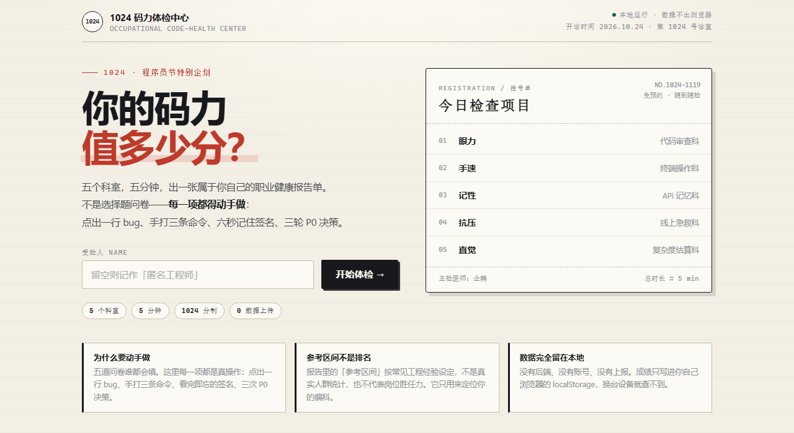
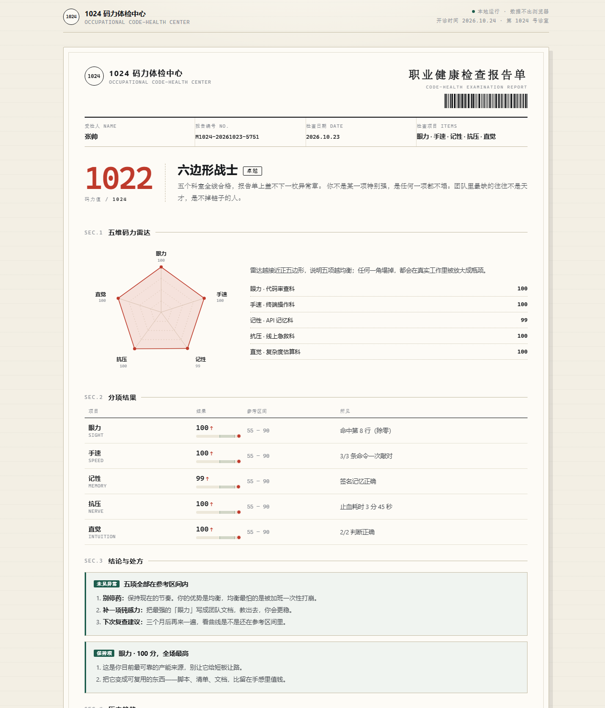
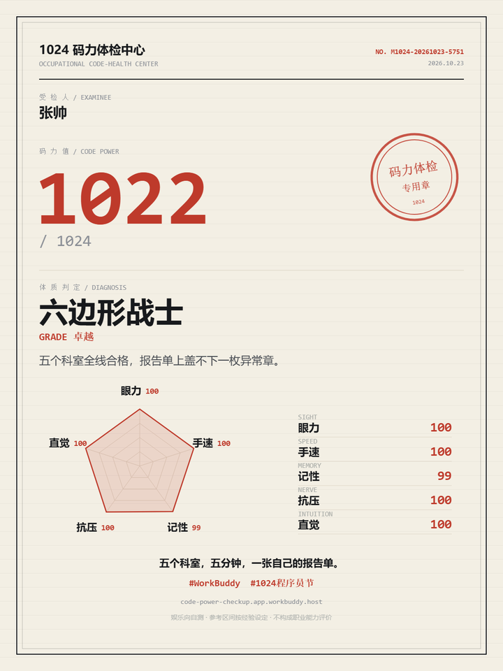

# 1024 码力体检中心

> 五个科室，五分钟，出一张属于程序员的职业健康报告单。

在线体验：**https://code-power-checkup.app.workbuddy.host/?sharecode=2TJGCNLRHB**

备用入口（GitHub Pages）：https://zhangsdx.github.io/1024-code-power-checkup/

WorkBuddy「1024 造物挑战」程序员节应用创作大赛参赛作品。



## 这不是一份问卷

五道"你觉得自己抗压吗"的选择题，谁都会填。这里每一项都要动手：

| 科室 | 你要做的事 | 限时 |
| --- | --- | --- |
| 眼力 · 代码审查科 | 在 9 行 Python 里点出那行会炸的代码（空数据除零） | 40s |
| 手速 · 终端操作科 | 照着敲 3 条命令，逐字比对、统计手误 | 45s |
| 记性 · API 记忆科 | 接口签名只给你 6 秒，收回后四选一 | 6s + 15s |
| 抗压 · 线上急救科 | 3 轮 P0 处置，HUD 实时累计"止血耗时" | 18s × 3 |
| 直觉 · 复杂度估算科 | 判断 O(n log n)、估 10⁹ 次运算的量级 | 20s × 2 |

每一项都有即时解析：选错不是只给正确答案，而是告诉你为什么那一行是雷、为什么顺序反了会扩大事故。

## 报告长什么样



- **码力值**：五维各 0–100，取均值 ×10.24，满分正好 **1024**
- **体质判定**：六边形战士 / 人形 CR 机器人 / 肌肉记忆键盘侠 / 行走的 API 文档 / 线上急诊科主任 / 复杂度直觉怪 / 养生型工程师
- **分项结果**：带参考区间的条带、越界标记、这项到底测出了什么
- **异常项与处方**：低于 60 分的项给三条能立刻执行的动作，不是"多写代码就好了"
- **历史趋势**：本机多次体检的码力值曲线
- 可打印成 PDF，可生成 1080×1440 分享卡



## 关于"参考区间"

报告里每一栏都标着 `55 – 90` 的参考区间，并明确写着**按常见工程经验设定，不是真实人群统计**。

没有任何"你超过了 87% 的程序员"——那需要真实样本，编一个数字很容易，但它会让人误判自己。

## 技术

- **单文件** `index.html`，约 86 KB，零依赖、零构建、无后端，双击就能跑
- 雷达图手写 SVG，分享卡 Canvas 手绘，历史记录存 `localStorage`
- 全流程键盘可用，移动端自适应（390px 起），支持 `prefers-reduced-motion`
- 计时器与评分全部在客户端完成，没有任何网络请求

### 本地运行

```bash
git clone https://github.com/zhangsdx/1024-code-power-checkup.git
cd 1024-code-power-checkup
# 直接双击 index.html，或起一个静态服务：
npx serve .
```

### 浏览器

Chrome / Edge / Safari / Firefox 近两年版本均可（用到 `clamp()`、`aspect-ratio`、`backdrop-filter`）。

## 隐私

没有账号、没有埋点、没有上报。成绩只写进你自己浏览器的 `localStorage`，换台设备打开就是空的。

## 已知取舍

- **题目是固定的**：五道题适合自测和分享，不适合当严肃测评工具，多测几次会记住答案。
- **分数是娱乐向的**：1024 分制是为了呼应程序员节，不构成任何职业能力评价。
- **参考区间是经验值**：见上一节，故意没有做假的同龄人对比。
- **首屏无样例报告**：为了不剧透题目，只能自己测一遍才看得到报告。

## 关于

作者：[@zhangsdx](https://github.com/zhangsdx)
仓库：[zhangsdx/1024-code-power-checkup](https://github.com/zhangsdx/1024-code-power-checkup)

如果这个作品让你想去测一次，欢迎点个 Star。

## License

[MIT](LICENSE) © 2026 zhangsdx
